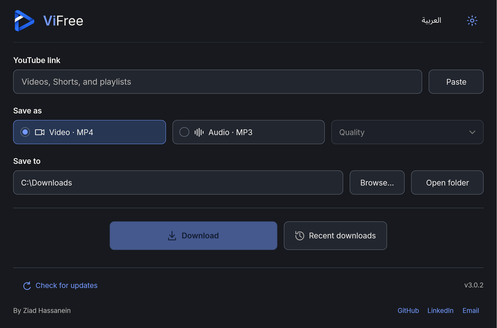
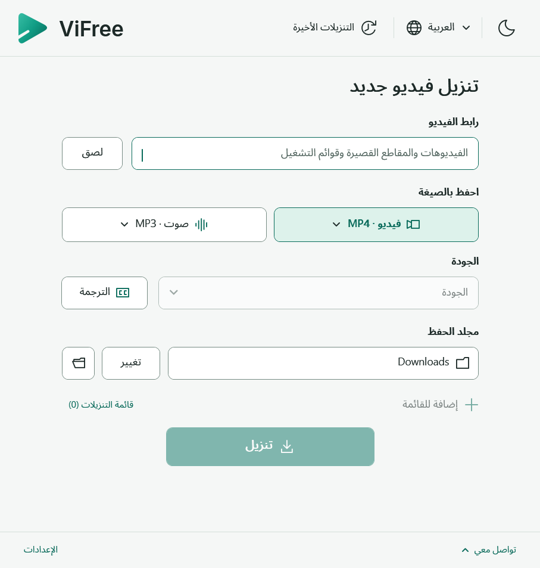

# ViFree

A free Windows app by **Ziad Hassanein** for downloading YouTube videos, Shorts and playlists as MP4 or MP3 (192/320 kbps). English and Arabic, with dark and light themes.

**[Download for Windows (.zip)](https://github.com/ZiadHassanein/ViFree-Downloads/releases/download/v3.0.1/ViFree-v3.0.1-win-x64.zip)**

Windows 10/11 x64. Extract the ZIP and open `ViFree.exe`. No separate runtime or tool setup; missing tools download automatically when needed.

  
  

Screenshots show the previous YouTube Downloader v1.0.14.

## Use

1. Paste a video or playlist link.
2. Choose MP4 or MP3, quality, and a save folder.
3. Click **Download**. For playlists, choose **Whole playlist**.

Updates are manual through **Check for updates**. Existing copies through ViFree 3.0.0 need one manual ZIP download to switch to the public download channel; your settings and files are retained.

Only download content you have permission to save. Protected and sign-in-only videos are unsupported.

## العربية

نزّل ملف ZIP أعلاه وافتح `ViFree.exe`. الصق الرابط، واختر الصيغة والجودة ومجلد الحفظ، ثم اضغط **تنزيل**. لقائمة تشغيل كاملة اختر **قائمة التشغيل كاملة**. الأدوات الناقصة تُجهّز تلقائيًا، والتحديثات يدوية.

[GitHub](https://github.com/ZiadHassanein) · [LinkedIn](https://www.linkedin.com/in/ziad-hassanein/) · [Email](mailto:ziadmuhammed501@gmail.com)

[Developer documentation](ARCHITECTURE.md) · [Third-party notices](THIRD-PARTY-NOTICES.txt)
