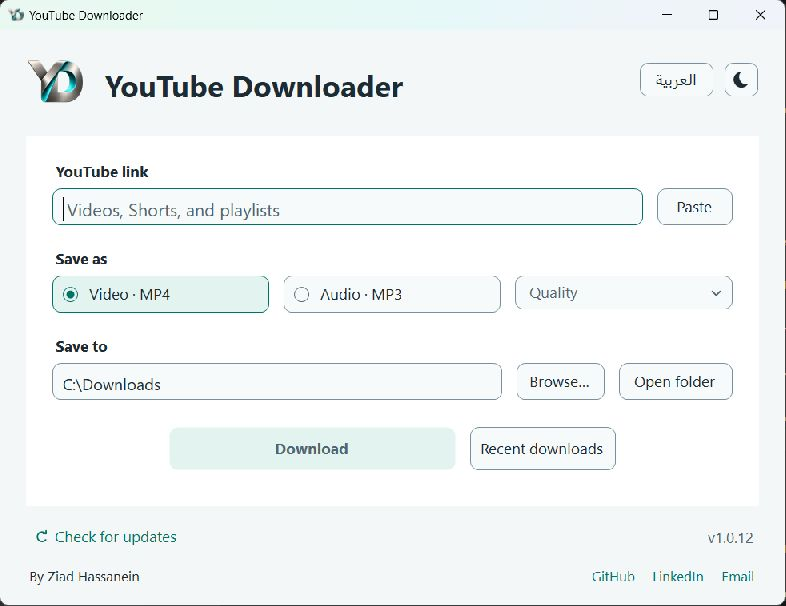
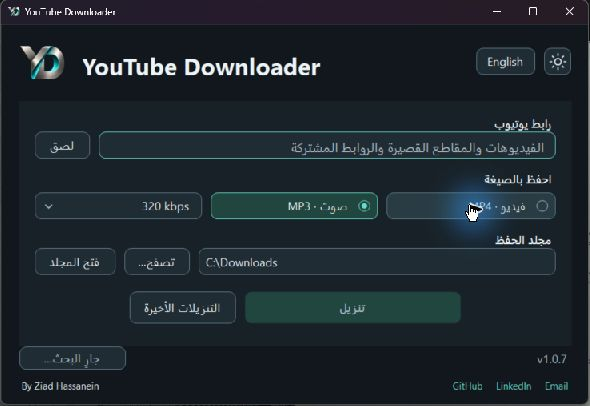
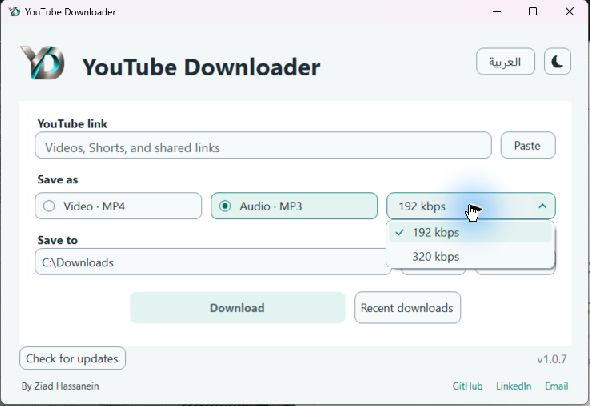
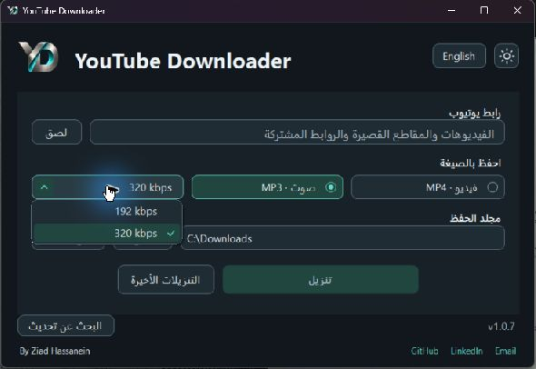

<p align="center"></p>

# YouTube Downloader for Windows

A desktop app for saving YouTube videos as MP4 or extracting MP3 audio. Paste a link, choose an available quality and a destination, then download.

**[Download the latest Windows release](https://github.com/ZiadHassanein/youtube-downloader-windows/releases/latest)**

| English · light | Arabic · dark |
| --- | --- |
|  |  |

| Light option list | Dark option list |
| --- | --- |
|  |  |

## Get started

1. Download `YouTubeDownloader-v1.0.9-windows-x64.zip` from the release page.
2. Extract the ZIP to a writable folder.
3. If yt-dlp, FFmpeg, or Deno are missing, run `SetupTools.cmd` once. It installs only missing tools through Windows Package Manager.
4. Open `YouTubeDownloader.exe`, paste a video link, and wait for its available qualities to appear.
5. Choose MP4 video or MP3 audio, select a save folder, and click **Download**.
6. Use **Show in folder** after a download to find its file in File Explorer, or select a file in **Recent downloads** to reveal it later.

Windows 10/11 x64 and .NET Framework 4.8 are required. Windows 11 includes the required framework. The first-time setup script requires WinGet.

## Features

- Automatic video inspection and actual available-resolution choices.
- A sensible default: the highest available resolution up to 1080p.
- Support for normal video links, Shorts, and shared links.
- MP4 output and MP3 audio encoding at 192 or 320 kbps, with 320 kbps as the default.
- Progress, speed, cancellation, and resumable partial files.
- Separate video filenames for different quality selections.
- Existing completed files are preserved.
- Defaults to Downloads without a YouTube subfolder; the previous default is migrated once and custom save folders are preserved.
- Dark by default, with a sun/moon icon toggle and your theme choice remembered.
- Smooth vector sun/moon icons that scale with the theme button at larger Windows display sizes.
- English with an LTR layout or Arabic with an RTL layout, selectable from the header and remembered.
- Language changes repaint immediately and keep every active control visible.
- The English app name stays on the left in both languages, with a simpler link-to-download layout.
- Immediate theme repaint with a brief 120 ms icon transition that respects Windows animation settings.
- Equal-width MP4 / MP3 / quality controls filling the row, with rounded inputs and buttons.
- Refined quality dropdown with a larger chevron, themed rounded options, and a checkmark for the current selection.
- Automatic checks on paste, a helpful link placeholder, and concise errors with recovery steps.
- Clear feedback when the app is up to date or an update check fails.
- Update action on the left and a simple version label on the right in both languages.
- Author credit stays on the left and social links stay on the right in both languages.
- Theme-matched scrolling, anchored folder/update popovers, and automatic message dismissal after five seconds.
- A larger transparent YD mark in the app header and taskbar.
- Link cleared after a successful download; every launch starts with an empty link.
- A larger centered Download action, matching Browse/Open folder controls, and recent-download history in a themed modal.
- Show in folder after completion and for the selected recent download, with the file highlighted in File Explorer.
- Saved preferences and history; idle status stays out of the way while progress and errors remain visible.
- The window fits its content, and all popovers stay within the app's borders.
- Checks GitHub for a new app version on launch; install it from inside the app.

Playlist-only links and sign-in-only videos are not supported. A video link containing a playlist downloads only the linked video. The app does not read browser cookies or automatically update its dependencies.

## App updates

The app checks this repository's latest stable release in the background when it opens. You can also choose **Check for updates**. Updates are installed only when you choose **Install v…**. It downloads the Windows package, verifies its SHA-256 checksum and executable version, then restarts the app. You can instead download and extract a release manually. Preferences and recent downloads are preserved. The app folder must be writable. This updates the downloader app only; yt-dlp, FFmpeg, and Deno are managed separately.

## Dependencies

The app calls these separately installed tools:

- [yt-dlp](https://github.com/yt-dlp/yt-dlp) for YouTube extraction and downloads.
- [FFmpeg](https://ffmpeg.org/) for media merging and MP3 conversion.
- [Deno](https://deno.com/) for yt-dlp's YouTube JavaScript support.

It checks a `tools` folder beside the app, the current user's WinGet Links folder, and PATH. Third-party binaries are not bundled in this release and retain their own licenses.

## Privacy

Preferences and recent local file paths stay in `settings.json` beside the app. Video links are not saved. That file, downloads, and personal histories are excluded from the repository and release ZIP. Update checks contact GitHub; they do not send your video links or history.

## Build

On Windows with .NET Framework installed:

```powershell
powershell -NoProfile -ExecutionPolicy Bypass -File scripts/build.ps1
```

The compiled app and release ZIP appear in `dist`. No NuGet packages are required.

Run the deterministic core checks:

```powershell
powershell -NoProfile -ExecutionPolicy Bypass -File scripts/test.ps1
```

## Author

Created by **Ziad Hassanein**.

[GitHub](https://github.com/ZiadHassanein) · [LinkedIn](https://www.linkedin.com/in/ziad-hassanein/) · [Email](mailto:ziadmuhammed501@gmail.com)
