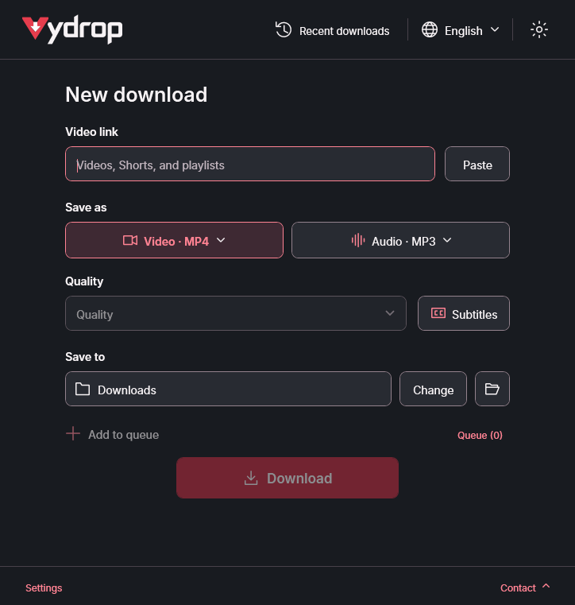
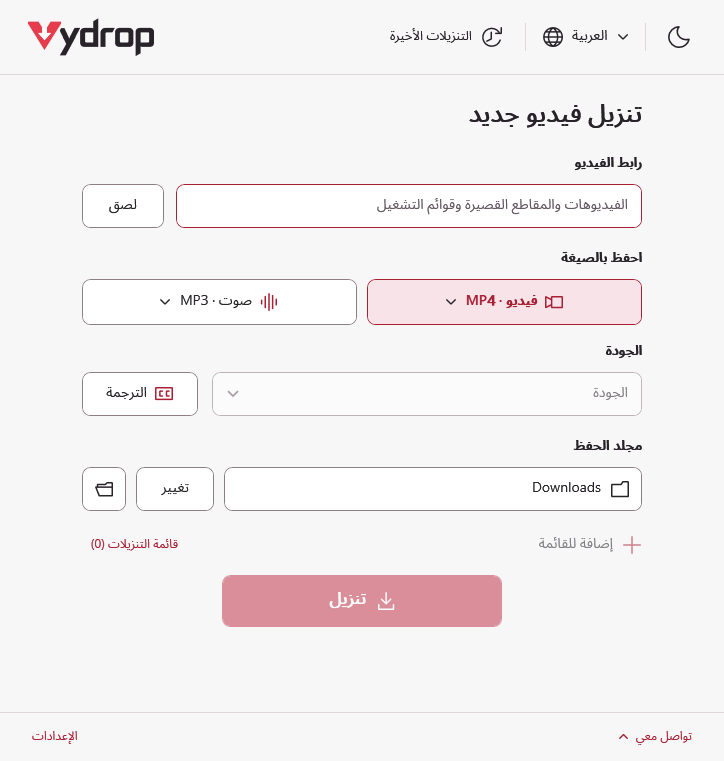
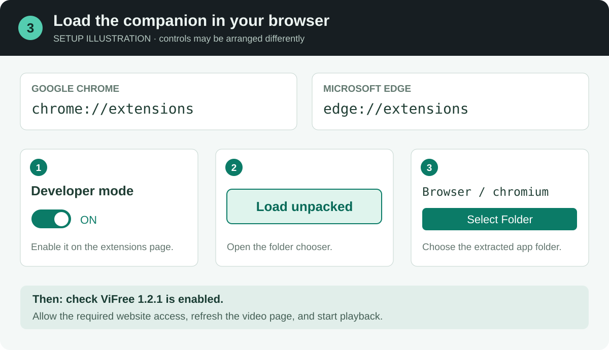
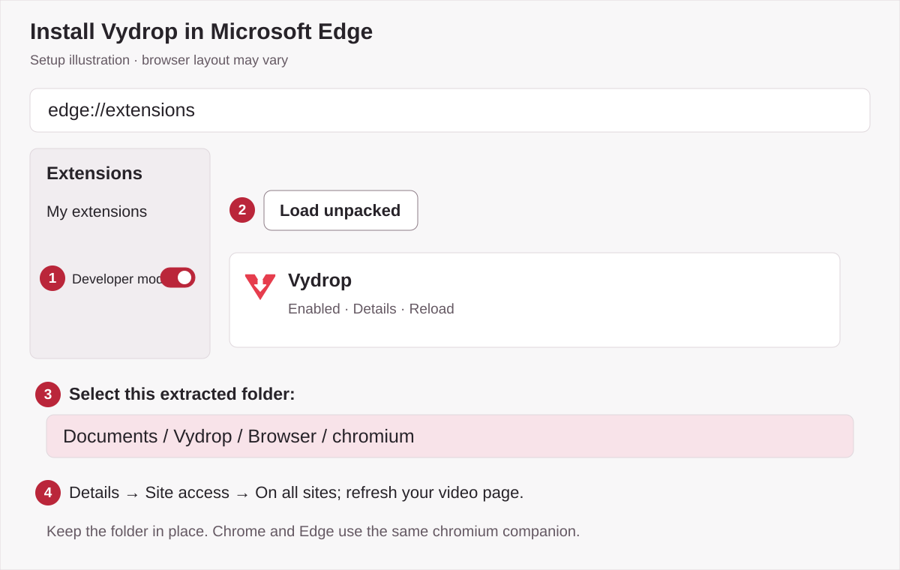
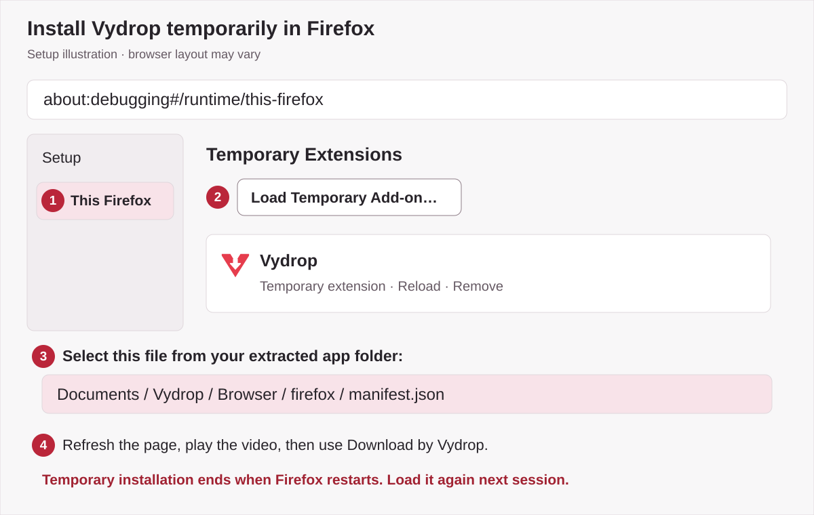

<p align="center"><picture><source media="(prefers-color-scheme: dark)" srcset="assets/brand-logo-dark.svg"></picture></p>

<p align="center">
  <a href="https://github.com/ZiadHassanein/Vydrop/releases/download/v4.2.1/Vydrop-v4.2.1-win-x64.zip"></a>
  <br><br>
  <a href="https://github.com/ZiadHassanein/Vydrop/releases"></a>
</p>

<a id="theme-previews"></a>

<p align="center">
  <a href="docs/images/screenshots/vydrop-dark-en-download.png"></a>
  <a href="docs/images/screenshots/vydrop-light-ar-download.png"></a>
</p>

<p align="center"><em>Native 100% scale client renders of the 4.2.0 source interface, without a pointer. Browser setup images below are labelled illustrations.</em></p>

# Vydrop — Free Video & Audio Downloader for Windows

**Vydrop (formerly ViFree)** is a free, open-source Windows video and audio downloader by **Ziad Hassanein**. Download public media from YouTube, TikTok, Facebook, Vimeo and 1,000+ sites supported by yt-dlp, plus compatible direct media links. English and Arabic, playlists, queues, subtitles and an optional browser companion are included.

<details>
<summary>About the download count</summary>

GitHub counts release downloads, including repeats and automated downloads; this is not a count of unique people, installations or active users. The cached badge is provided by Shields.io. For ZIP counts by version, run `./scripts/download-counts.ps1`. No app telemetry, paid service or API key is added.

</details>

[Documentation](https://ziadhassanein.github.io/Vydrop/) · [العربية](https://ziadhassanein.github.io/Vydrop/ar/) · [Setup guide](#getting-started) · [Theme previews](#theme-previews) · [Extension setup with pictures](docs/browser-extension-setup.md) · [Report a download problem](https://github.com/ZiadHassanein/Vydrop/issues)

## Latest release: Vydrop 4.2.1

**Vydrop 4.2.1** fixes update-file cleanup, avoids duplicate queue inspections, improves browser handoff when the app is busy, and completes Arabic error messages. Companion **1.3.1** adds Arabic popup and context-menu text. The approved red identity and compact interface are retained.

| Channel | Version | What to use |
| --- | --- | --- |
| Latest stable release | Vydrop 4.2.1 | The Windows ZIP linked above; extract it and open Vydrop.exe. |
| Included companion | Vydrop 1.3.1 | Chrome, Edge and Firefox folders inside Browser. |
| Previous release | ViFree 4.1.0 | Superseded by Vydrop; earlier validation is preserved in [Preview 30 details](PREVIEW.md). |

This is the official repository for Vydrop source code, Windows downloads, release notes and support. The source is MIT licensed.

## Download from YouTube and 1,000+ sites

### At a glance

<!-- facts:start -->
**Vydrop (formerly ViFree and YouTube Downloader)** is a free, MIT-licensed video and audio downloader for Windows 10/11 x64. Version **4.2.1** uses yt-dlp for public pages from 1,000+ supported sites, including YouTube, TikTok, Facebook, Vimeo, X/Twitter, Reddit, Dailymotion and Twitch clips, plus direct MP4/MP3 links. Video outputs: MP4, MKV, WebM. Audio outputs: MP3, M4A, Opus, WAV, FLAC. It supports playlists, queues, SRT/VTT subtitles, an optional browser companion, English and Arabic. Private, sign-in-only and DRM-protected media are unsupported. Settings, history and media tools stay locally in `%LocalAppData%\YouTubeDownloader`; downloads use your chosen folder. Vydrop has no telemetry.
<!-- facts:end -->

Vydrop retains these download features:

| Task | Support |
| --- | --- |
| Supported public sites | YouTube, TikTok, Facebook, Vimeo, X/Twitter, Reddit, Dailymotion, Twitch clips and other yt-dlp-supported pages; compatible direct MP4/MP3 links. [Scope and limits](docs/supported-sites.md). |
| Download video | Public videos, Shorts and playlist entries; MP4, MKV and WebM when inspected streams fit the chosen container. |
| Save audio | MP3, M4A, Opus, WAV and FLAC. Conversion bitrate choices respect the reported source estimate; unknown sources offer Automatic. |
| Manage playlists and queues | Choose playlist entries, add individual links to a queue, follow progress and open completed files in their folder. |
| Save subtitles | Choose an available subtitle language and SRT or VTT format. The media details show the selection. |
| Review a link | Preview title, duration, artwork and measured quality before downloading. |
| Use your language | English/LTR and Arabic/RTL, light and dark themes, and keyboard-accessible controls. |
| Prepare media tools | Reuse compatible installed tools or automatically download and verify missing yt-dlp, FFmpeg/FFprobe and Deno tools. |

Quality depends on the source. A higher output bitrate or a lossless file does not restore detail missing from the original audio. Video choices reflect inspected or measured formats.

## Browser extension: Download by Vydrop

The optional **Chrome, Microsoft Edge and Firefox** companion **1.3.1** is in the Vydrop 4.2.1 ZIP's `Browser` folder. The companion shows a **Download by Vydrop** tab outside a playing video's top-right border. Clicking it copies the resolved link and opens Vydrop for review; downloading still requires your action in the app.

Facebook, TikTok and YouTube detection uses the selected player's public permalink. Other HTML5 players may provide a direct media URL or a single-video page link. Available space, custom players and site restrictions can limit detection. Use the toolbar popup when the tab cannot be placed safely.

Follow the **[illustrated extension setup guide](docs/browser-extension-setup.md)** for Chrome, Edge and Firefox, including [Arabic instructions](docs/browser-extension-setup.md#arabic). See [permissions and limitations](browser/README.md) for more detail. The extension does not import accounts or cookies and does not start hidden downloads. Reload an older unpacked companion after updating its folder, or load the new ZIP's `Browser` companion.


Start in the app with **Settings → Browser integration → Enable connection**, then choose your browser:

| Browser | Open this address | Install from the extracted folder |
| --- | --- | --- |
| [Chrome guide](docs/browser-extension-setup.md#chrome) | `chrome://extensions` | Developer mode → Load unpacked → `Browser/chromium` |
| [Edge guide](docs/browser-extension-setup.md#edge) | `edge://extensions` | Developer mode → Load unpacked → `Browser/chromium` |
| [Firefox guide](docs/browser-extension-setup.md#firefox) | `about:debugging#/runtime/this-firefox` | Load Temporary Add-on → `Browser/firefox/manifest.json` |

<p align="center">
  <a href="docs/browser-extension-setup.md#chrome"></a>
  <a href="docs/browser-extension-setup.md#edge"></a>
  <a href="docs/browser-extension-setup.md#firefox"></a>
</p>

Keep the extracted folder, allow access to the desired websites and refresh open video pages. **Firefox's local add-on must be loaded again after a browser restart.** These packages are not browser-store listings. The [full illustrated guide](docs/browser-extension-setup.md) covers every step, updates and troubleshooting.

## Getting started

1. Download the [official stable Windows ZIP](https://github.com/ZiadHassanein/Vydrop/releases/download/v4.2.1/Vydrop-v4.2.1-win-x64.zip), extract it into a writable folder, and open **Vydrop.exe**. Target platform: Windows 10/11 x64; the .NET runtime is bundled.
2. Paste a video or playlist link, choose output, quality and a save folder, then click **Download**.
3. Choose the Video/Audio format buttons and **Subtitles** for captions. Use **Choose videos** for playlist entries and **Queue** for multiple links.

Internet access is required for downloads and missing-tool preparation. No account, API key or paid service is required. Only save media you have permission to download; DRM-protected and sign-in-only content is unsupported.

**Upgrading from ViFree or YouTube Downloader to Vydrop:** close the old app and extract the Vydrop ZIP into a new writable folder once. Stable preferences, history and verified media tools retain their existing storage location. Enable Browser integration from Vydrop to refresh the executable path. Existing companion IDs and permissions are retained.

**App updates after the repository rename:** versions through 4.2.1 still check the former ViFree API. Use the [releases page](https://github.com/ZiadHassanein/Vydrop/releases) for manual app updates. The new endpoint is prepared in source for a future desktop release; the published v4.2.1 ZIP is unchanged.

## Frequently asked questions

<!-- faq:start -->
### Can Vydrop download videos from sites other than YouTube?

Yes. Vydrop uses yt-dlp for public pages from 1,000+ supported sites, including TikTok, Facebook, Vimeo, X/Twitter, Reddit, Dailymotion and Twitch clips. Direct MP4/MP3 links also work. Site changes and access restrictions can prevent a particular download.

### Is there a free open-source Windows downloader with Arabic?

Yes. Vydrop is free under the MIT license, runs on Windows 10/11 x64, and includes English and Arabic interfaces with light and dark themes. The .NET runtime is bundled; missing media tools are prepared automatically.

### Does Vydrop download TikTok, Facebook, Vimeo or X videos?

Yes, when the public video is supported by yt-dlp and available without signing in. Paste the video’s own link, not the homepage. The extension can resolve a playing video, but custom players and site restrictions can limit detection.

### Can I download a video playing in my browser?

Use the optional Chrome, Edge or Firefox companion. Enable Browser integration in Vydrop, then click Download by Vydrop beside a playing video. It copies the resolved link and opens the app for review. You choose Download in the app; detection is not guaranteed on every website.

### How do I save a YouTube playlist as MP3 on Windows?

Paste a public playlist link, choose Whole playlist, select the entries, choose Audio → MP3 and an available audio quality, then choose Download. The app processes the selected entries in order. Available quality depends on the original audio.

### Does Vydrop need an account, API key or subscription?

No. Vydrop needs no account, API key or paid subscription. It contacts media sites and official update servers when needed. It does not import browser cookies, bypass sign-in or decrypt DRM. Only download media you have permission to save.

### What happens when a website changes?

Vydrop checks for verified yt-dlp and Deno updates once daily when you use a link and can try one compatible update-and-retry. A site may still require an upstream fix. Use Settings → Update downloader for a manual check; application updates are separate.
<!-- faq:end -->

## Why Vydrop?

| Task | Vydrop | yt-dlp command line | Web converters |
| --- | --- | --- | --- |
| Multiple public sites | yt-dlp support in one window | yt-dlp support | Depends on the service |
| Controls | English/Arabic desktop UI | Command arguments | Browser form; varies |
| Media tools | Missing tools prepared automatically | User manages tools | Service manages tools |
| Playlists, captions, queue | App controls | Command options and scripts | Depends on the service |
| Cost and advertising | Free, no ads | Free, no ads | Pricing and ads vary |
| Browser handoff | Optional companion | Requires another integration | Varies |

Each web service differs. This compares workflows, not other products’ safety.

## Build from source

On Windows, install the **.NET 10 SDK**. **Node.js 20+** is also required for browser-companion tests.

```powershell
./scripts/check.ps1
./scripts/package.ps1 -Version 4.2.1
```

Preview builds use separate settings and tool state. Read [Contributing](CONTRIBUTING.md), [Architecture](ARCHITECTURE.md) and [Security](SECURITY.md) before making changes.

## Vydrop بالعربية — برنامج تنزيل الفيديو والصوت لويندوز

<div dir="rtl" lang="ar">

**Vydrop** برنامج مجاني ومفتوح المصدر من تطوير **زياد حسنين**، لتنزيل الفيديو والصوت من الصفحات العامة في يوتيوب وتيك توك وفيسبوك وVimeo وأكثر من ١٠٠٠ موقع مدعوم عبر yt-dlp، إضافة إلى روابط الوسائط المباشرة. يدعم العربية والإنجليزية والمظهرين الفاتح والداكن، مع قائمة تنزيلات واختيار فيديوهات القائمة وحفظ الترجمة المتاحة.

الإصدار الحالي هو **Vydrop 4.2.1**، ويحسّن تنظيف ملفات التحديث والربط بالمتصفح ورسائل الأخطاء العربية، ويشمل إضافة المتصفح **1.3.1**. [نزّل ملف Windows ZIP](https://github.com/ZiadHassanein/Vydrop/releases/download/v4.2.1/Vydrop-v4.2.1-win-x64.zip)، ثم فكّ الضغط وافتح **Vydrop.exe**. تُجهّز الأدوات الناقصة تلقائيًا، ولا يلزم حساب أو مفتاح API أو خدمة مدفوعة. عند الترقية من ViFree، احتفظ بالإعدادات والملفات الحالية، وفعّل الربط بالمتصفح من Vydrop ثم أعد تحميل الإضافة. راجع [دليل تفعيل Chrome وEdge وFirefox بالصور](docs/browser-extension-setup.md#arabic). تختلف إمكانية التنزيل حسب الموقع وإتاحة الفيديو وجودة المصدر.

### أسئلة شائعة

### هل ينزّل Vydrop الفيديو من مواقع غير يوتيوب؟

نعم. يستخدم Vydrop أداة yt-dlp للصفحات العامة في أكثر من ١٠٠٠ موقع مدعوم، منها تيك توك وفيسبوك وVimeo وX وReddit وDailymotion ومقاطع Twitch، إضافة إلى روابط MP4 وMP3 المباشرة. قد تمنع تغييرات الموقع أو قيود الوصول تنزيل رابط معيّن.

### هل يوجد برنامج تنزيل مجاني ومفتوح المصدر لويندوز بواجهة عربية؟

نعم. Vydrop مجاني بترخيص MIT ويعمل على Windows 10/11 x64، مع واجهتين عربية وإنجليزية ومظهرين فاتح وداكن. بيئة .NET مضمّنة، وتُجهّز أدوات الوسائط الناقصة تلقائيًا.

### هل يدعم Vydrop فيديوهات تيك توك وفيسبوك وVimeo وX؟

نعم، عندما يكون الفيديو عامًا ومدعومًا عبر yt-dlp ومتاحًا دون تسجيل دخول. الصق رابط الفيديو نفسه بدل الصفحة الرئيسية. تستطيع الإضافة تحديد الفيديو الجاري تشغيله، لكن بعض المشغّلات وقيود المواقع قد تمنع اكتشافه.

### هل يمكن تنزيل الفيديو الذي أشاهده في المتصفح؟

استخدم إضافة Chrome أوEdge أوFirefox الاختيارية. فعّل الربط بالمتصفح داخل Vydrop، ثم اضغط «تنزيل بواسطة Vydrop» بجانب الفيديو الجاري تشغيله. تنسخ الإضافة الرابط وتفتح التطبيق لمراجعته، ثم تختار التنزيل. لا يُضمن اكتشاف الفيديو في كل موقع.

### كيف أحفظ قائمة تشغيل يوتيوب بصيغة MP3 على ويندوز؟

الصق رابط قائمة عامة، واختر القائمة كاملة ثم الفيديوهات المطلوبة. اختر الصوت ثم MP3 وجودة الصوت المتاحة، واضغط تنزيل. يعالج التطبيق العناصر المحددة بالترتيب، وتعتمد الجودة على الصوت الأصلي.

### هل يحتاج Vydrop إلى حساب أو مفتاح API أو اشتراك؟

لا. لا يحتاج Vydrop إلى حساب أو مفتاح API أو اشتراك مدفوع. يتصل بمواقع الوسائط وخوادم التحديث الرسمية عند الحاجة، ولا يستورد ملفات تعريف الارتباط أو يتجاوز تسجيل الدخول أو يفك DRM. نزّل فقط ما تملك إذنًا بحفظه.

### ماذا يحدث عندما يغيّر موقع طريقة عمله؟

يفحص Vydrop تحديثات yt-dlp وDeno المتحقق منها مرة يوميًا عند استخدام رابط، وقد يحدّث الأدوات ويعيد المحاولة مرة واحدة عند خطأ متوافق. قد يظل الحل بحاجة إلى إصلاح من المطوّرين الأصليين. للفحص اليدوي اختر الإعدادات ثم تحديث أداة التنزيل؛ تحديث التطبيق منفصل.

[الأدلة العربية](docs/ar/index.md) · [المواقع والقيود](docs/ar/supported-sites.md)

</div>

## Author and support

Created by **Ziad Hassanein**. [GitHub](https://github.com/ZiadHassanein) · [LinkedIn](https://www.linkedin.com/in/ziad-hassanein/) · [Email](mailto:ziadmuhammed501@gmail.com).

Use [GitHub issues](https://github.com/ZiadHassanein/Vydrop/issues) for app problems and development reports. Include your app version, Windows version and the public link involved; never post passwords or cookies.
