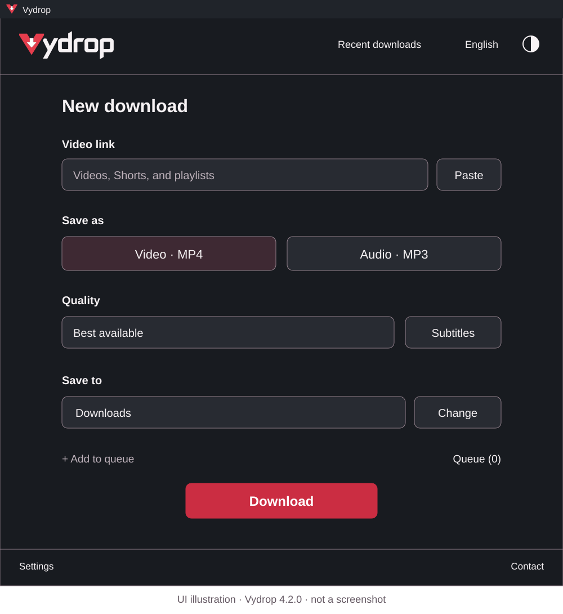
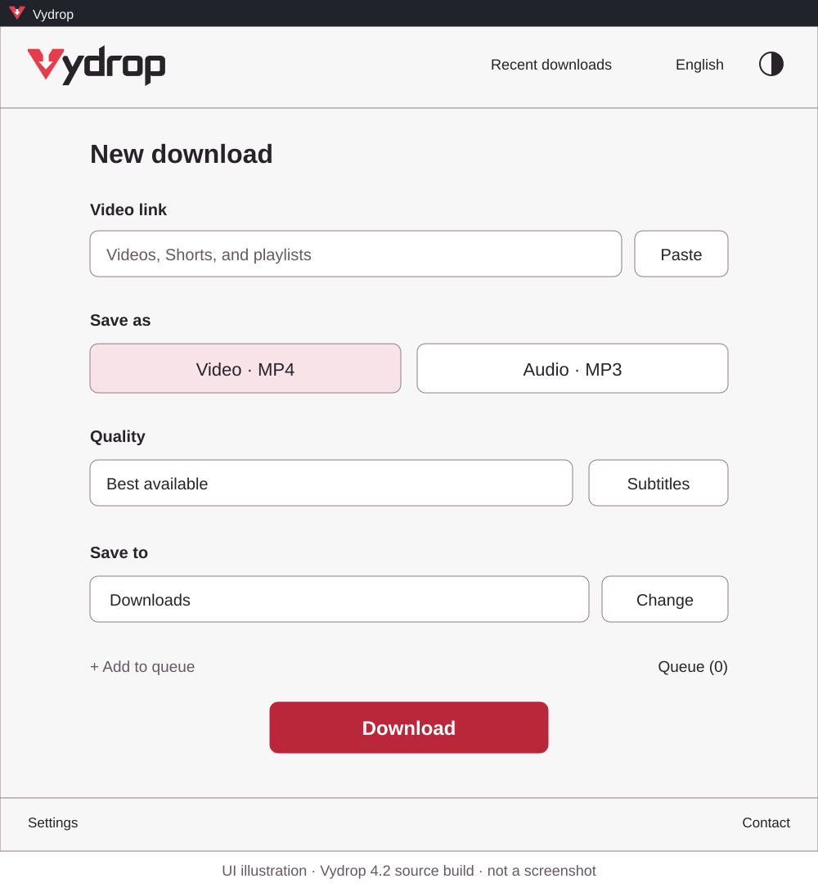

<p align="center"><picture><source media="(prefers-color-scheme: dark)" srcset="assets/brand-logo-dark.svg"></picture></p>

<a id="theme-previews"></a>

<p align="center">
  <a href="docs/images/app-overview-dark.svg"></a>
  <a href="docs/images/app-overview-light.svg"></a>
</p>

<p align="center"><em>Vydrop 4.2.0 interface — labelled illustrations, not screenshots. Click to view at full size.</em></p>

# Vydrop — Free Video & Audio Downloader for Windows

**Vydrop (formerly ViFree)** is a free, open-source Windows desktop app by **Ziad Hassanein** for downloading YouTube videos, Shorts and playlists, saving audio, and organizing multiple downloads. It supports English and Arabic interfaces, light and dark themes, subtitles, and an optional browser extension. Other public websites depend on yt-dlp support and access.

**[Download Vydrop v4.2.0 for Windows (.zip)](https://github.com/ZiadHassanein/ViFree/releases/download/v4.2.0/Vydrop-v4.2.0-win-x64.zip)**

[Setup guide](#getting-started) · [Theme previews](#theme-previews) · [Extension setup with pictures](docs/browser-extension-setup.md) · [Report a download problem](https://github.com/ZiadHassanein/ViFree/issues)

## Latest release: Vydrop 4.2.0

**Vydrop 4.2.0** introduces the red V/download identity, matching light/dark wordmarks and browser companion **1.3.0**. The full wordmark shines on hover without a background plate. The theme button keeps its icon clear and the content steady when focused or clicked, and the contact menu has matching icon rows.

| Channel | Version | What to use |
| --- | --- | --- |
| Latest stable release | Vydrop 4.2.0 | The Windows ZIP linked above; extract it and open Vydrop.exe. |
| Included companion | Vydrop 1.3.0 | Chrome, Edge and Firefox folders inside Browser. |
| Previous release | ViFree 4.1.0 | Superseded by Vydrop; earlier validation is preserved in [Preview 30 details](PREVIEW.md). |

This is the official repository for Vydrop source code, Windows downloads, release notes and support. The source is MIT licensed.

## Video, audio and download features

Vydrop retains these download features:

| Task | Support |
| --- | --- |
| Download video | YouTube videos, Shorts and playlists; MP4, MKV and WebM when inspected streams fit the chosen container. |
| Save audio | MP3, M4A, Opus, WAV and FLAC. Conversion bitrate choices respect the reported source estimate; unknown sources offer Automatic. |
| Manage playlists and queues | Choose playlist entries, add individual links to a queue, follow progress and open completed files in their folder. |
| Save subtitles | Choose an available subtitle language and SRT or VTT format. The media details show the selection. |
| Review a link | Preview title, duration, artwork and measured quality before downloading. |
| Use your language | English/LTR and Arabic/RTL, light and dark themes, and keyboard-accessible controls. |
| Prepare media tools | Reuse compatible installed tools or automatically download and verify missing yt-dlp, FFmpeg/FFprobe and Deno tools. |

Quality depends on the source. A higher output bitrate or a lossless file does not restore detail missing from the original audio. Video choices reflect inspected or measured formats.

## Browser extension: Download by Vydrop

The optional **Chrome, Microsoft Edge and Firefox** companion **1.3.0** is in the Vydrop 4.2.0 ZIP's `Browser` folder. The companion shows a **Download by Vydrop** tab outside a playing video's top-right border. Clicking it copies the resolved link and opens Vydrop for review; downloading still requires your action in the app.

Facebook, TikTok and YouTube detection uses the selected player's public permalink. Other HTML5 players may provide a direct media URL or a single-video page link. Available space, custom players and site restrictions can limit detection. Use the toolbar popup when the tab cannot be placed safely.

Follow the **[illustrated extension setup guide](docs/browser-extension-setup.md)** for Chrome, Edge and Firefox, including [Arabic instructions](docs/browser-extension-setup.md#arabic). See [permissions and limitations](browser/README.md) for more detail. The extension does not import accounts or cookies and does not start hidden downloads. Reload an older unpacked companion after updating its folder, or load the new ZIP's `Browser` companion.


Start in the app with **Settings → Browser integration → Enable connection**, then choose your browser:

| Browser | Open this address | Install from the extracted folder |
| --- | --- | --- |
| [Chrome guide](docs/browser-extension-setup.md#chrome) | `chrome://extensions` | Developer mode → Load unpacked → `Browser/chromium` |
| [Edge guide](docs/browser-extension-setup.md#edge) | `edge://extensions` | Developer mode → Load unpacked → `Browser/chromium` |
| [Firefox guide](docs/browser-extension-setup.md#firefox) | `about:debugging#/runtime/this-firefox` | Load Temporary Add-on → `Browser/firefox/manifest.json` |

<p align="center">
  <a href="docs/browser-extension-setup.md#chrome"></a>
  <a href="docs/browser-extension-setup.md#edge"></a>
  <a href="docs/browser-extension-setup.md#firefox"></a>
</p>

Keep the extracted folder, allow access to the desired websites and refresh open video pages. **Firefox's local add-on must be loaded again after a browser restart.** These packages are not browser-store listings. The [full illustrated guide](docs/browser-extension-setup.md) covers every step, updates and troubleshooting.

## Getting started

1. Download the [official stable Windows ZIP](https://github.com/ZiadHassanein/ViFree/releases/download/v4.2.0/Vydrop-v4.2.0-win-x64.zip), extract it into a writable folder, and open **Vydrop.exe**. Target platform: Windows 10/11 x64; the .NET runtime is bundled.
2. Paste a video or playlist link, choose output, quality and a save folder, then click **Download**.
3. Choose the Video/Audio format buttons and **Subtitles** for captions. Use **Choose videos** for playlist entries and **Queue** for multiple links.

Internet access is required for downloads and missing-tool preparation. No account, API key or paid service is required. Only save media you have permission to download; DRM-protected and sign-in-only content is unsupported.

**Upgrading from ViFree or YouTube Downloader to Vydrop:** close the old app and extract the Vydrop ZIP into a new writable folder once. Stable preferences, history and verified media tools retain their existing storage location. Enable Browser integration from Vydrop to refresh the executable path. Existing companion IDs and permissions are retained.

## Frequently asked questions

### Is Vydrop free and open source?

Yes. Vydrop's source is available under the [MIT license](LICENSE). Media tools retain their own licenses; see the [third-party notices](THIRD-PARTY-NOTICES.txt).

### Can Vydrop download YouTube videos as MP4 or MP3?

Yes. You can save supported YouTube videos, Shorts and playlist entries as video or audio. Available formats and quality depend on the media, app version and site access.

### Does Vydrop need a browser extension?

No. Pasting a link into the app works without an extension. The companion is an optional way to send the video you are watching to Vydrop.

### What happens when YouTube changes?

Vydrop retains the automatic maintenance introduced in ViFree 4.1.0: it checks for verified yt-dlp and Deno updates once daily when a link is used, retaining the previous tools and allowing one compatible update-and-retry. An upstream fix may still be needed. App-version updates are separate and manual; see [Preview 30 details](PREVIEW.md).

## Build from source

On Windows, install the **.NET 10 SDK**. **Node.js 20+** is also required for browser-companion tests.

```powershell
./scripts/check.ps1
./scripts/package.ps1 -Version 4.2.0
```

Preview builds use separate settings and tool state. Read [Contributing](CONTRIBUTING.md), [Architecture](ARCHITECTURE.md) and [Security](SECURITY.md) before making changes.

## Vydrop بالعربية — برنامج تنزيل الفيديو والصوت لويندوز

<div dir="rtl">

**Vydrop** برنامج مجاني ومفتوح المصدر من تطوير **زياد حسنين**، لتنزيل فيديوهات يوتيوب والمقاطع القصيرة وقوائم التشغيل وحفظ الصوت. يدعم العربية والإنجليزية والمظهرين الفاتح والداكن، مع قائمة تنزيلات واختيار فيديوهات القائمة وحفظ الترجمة المتاحة.

الإصدار الحالي هو **Vydrop 4.2.0**، ويشمل الهوية الحمراء الجديدة وإضافة المتصفح **1.3.0**. [نزّل ملف Windows ZIP](https://github.com/ZiadHassanein/ViFree/releases/download/v4.2.0/Vydrop-v4.2.0-win-x64.zip)، ثم فكّ الضغط وافتح **Vydrop.exe**. تُجهّز الأدوات الناقصة تلقائيًا، ولا يلزم حساب أو مفتاح API أو خدمة مدفوعة. عند الترقية من ViFree، احتفظ بالإعدادات والملفات الحالية، وفعّل الربط بالمتصفح من Vydrop ثم أعد تحميل الإضافة. راجع [دليل تفعيل Chrome وEdge وFirefox بالصور](docs/browser-extension-setup.md#arabic). تختلف إمكانية التنزيل حسب الموقع وإتاحة الفيديو وجودة المصدر.

</div>


## Author and support

Created by **Ziad Hassanein**. [GitHub](https://github.com/ZiadHassanein) · [LinkedIn](https://www.linkedin.com/in/ziad-hassanein/) · [Email](mailto:ziadmuhammed501@gmail.com).

Use [GitHub issues](https://github.com/ZiadHassanein/ViFree/issues) for app problems and development reports. Include your app version, Windows version and the public link involved; never post passwords or cookies.
