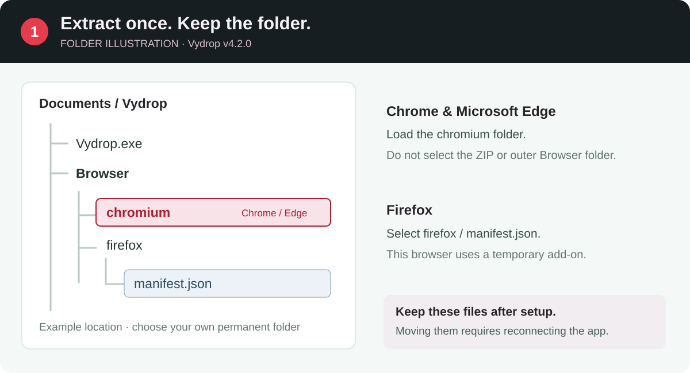
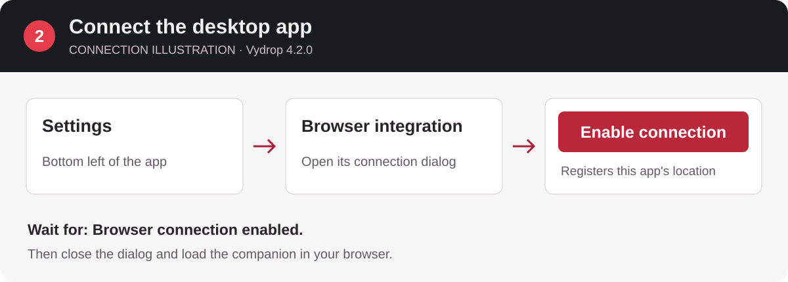
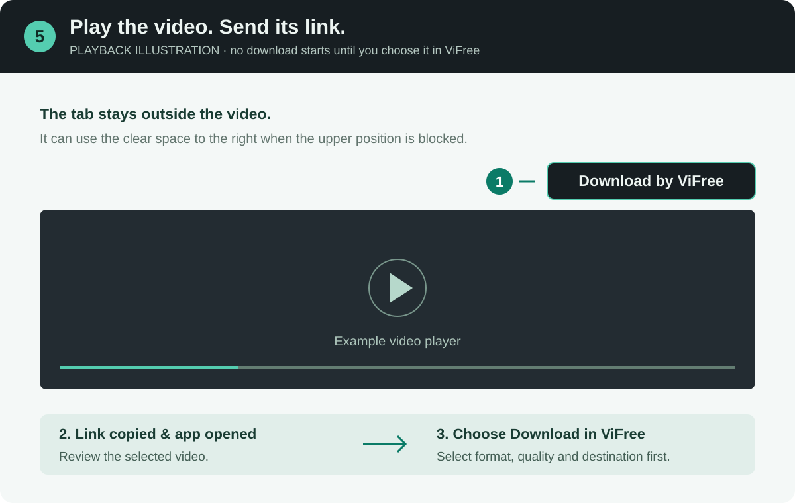

# إعداد إضافة Vydrop في Chrome وEdge وFirefox

الإضافة اختيارية ومجانية؛ تنسخ رابط الفيديو الجاري تشغيله وتفتحه في Vydrop للمراجعة. لا يبدأ التنزيل تلقائيًا ولا تُستورد بيانات الحساب.

## جهّز التطبيق

نزّل [أحدث إصدار رسمي](https://github.com/ZiadHassanein/ViFree/releases/latest) وفكّ الضغط في مجلد دائم قابل للكتابة، ثم افتح Vydrop.exe واحتفظ بمجلد Browser بجانبه. اختر **الإعدادات ← الربط بالمتصفح ← تفعيل الاتصال** وانتظر تأكيد التفعيل. عند نقل التطبيق فعّل الربط من مكانه الجديد.

## Google Chrome

1. افتح `chrome://extensions` وفعّل وضع المطوّر.
2. اختر **تحميل إضافة غير مضغوطة / Load unpacked** ثم مجلد `Browser/chromium` من الملفات المستخرجة.
3. اسمح بالوصول للمواقع المطلوبة وثبّت زر الإضافة في الشريط إن رغبت، ثم أعد تحميل صفحة الفيديو.

## Microsoft Edge

1. افتح `edge://extensions` وفعّل وضع المطوّر.
2. اختر **Load unpacked** ثم `Browser/chromium` نفسه؛ لا تختَر ملف ZIP.
3. وافق على الوصول للمواقع المطلوبة وأعد تحميل صفحة الفيديو.

## Mozilla Firefox

1. افتح `about:debugging#/runtime/this-firefox`.
2. اختر **Load Temporary Add-on** ثم `Browser/firefox/manifest.json`.
3. وافق على الأذونات المطلوبة وأعد تحميل صفحة الفيديو.

**هذه إضافة محلية مؤقتة وتحتاج إلى تحميلها من جديد بعد إعادة تشغيل Firefox.** الحزم المحلية ليست منشورة في متجر المتصفح.

## إرسال الفيديو وحل المشكلات

شغّل الفيديو واضغط «تنزيل بواسطة Vydrop» خارج زاويته العليا اليمنى، ثم راجع الرابط والمعلومات في التطبيق واضغط تنزيل. إذا تعذّر وضع الزر استخدم زر الإضافة في شريط المتصفح أو مشاركة ثم نسخ الرابط. لا تدعم الإضافة كل مشغّل، ولا تعني معرفة الرابط إمكان تنزيل فيديو خاص أو محمي أو يتطلب تسجيل دخول.

عند تحديث المجلد أعد تحميل الإضافة ثم صفحة الفيديو. إذا كان التطبيق مشغولًا، أنهِ التنزيل الحالي أو ألغِه ثم حاول مجددًا. عند فشل الربط افتح التطبيق وفعّله من الإعدادات. استخدم مجلد Browser من حزمة التطبيق المستقرة نفسها، وتجنّب خلطه مع Preview.

الصور توضيحات أصلية دون مؤشر فأرة وليست لقطات من المتصفح؛ قد تختلف مواضع الأزرار بحسب الإصدار.
