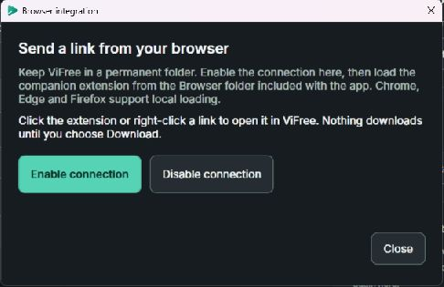
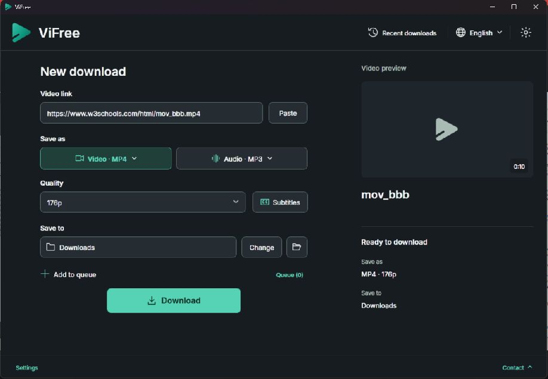

# Set up the ViFree browser extension

Send the video you are watching to **stable ViFree v4.1.0** with the optional **ViFree 1.2.1** companion. Setup is free and needs no account or API key. You can also paste links into the app without installing an extension.

[Download ViFree v4.1.0](https://github.com/ZiadHassanein/ViFree/releases/download/v4.1.0/ViFree-v4.1.0-win-x64.zip) · [Chrome and Edge](#chrome-and-edge) · [Firefox](#firefox) · [Help](#troubleshooting) · [العربية](#arabic)

## 1. Extract and keep the app folder

Extract the ZIP into a permanent, writable folder, such as **Documents\ViFree**, then open **ViFree.exe**. Keep the **Browser** folder beside the app. Open the extracted files, rather than running the app from inside the ZIP.

*Folder illustration. Your chosen location can differ.*

## 2. Enable the connection in the stable app

In ViFree, click **Settings** at the bottom left, then **Browser integration**. Click **Enable connection** in the dialog below. A confirmation says **Browser connection enabled**. Close the dialog when finished.

*Actual v4.1.0 dialog. This connects the app for your Windows account; the browser companion is loaded separately in the next step.*

## Chrome and Edge

### 3. Load the companion

1. In your browser's address bar, type **`chrome://extensions`** for Chrome, or **`edge://extensions`** for Edge, and press Enter.
2. Turn on **Developer mode** on that page.
3. Click **Load unpacked**.
4. Select the extracted app's **Browser\chromium** folder, then click **Select Folder**. Choose the folder containing `manifest.json`, rather than the ZIP or the outer `Browser` folder.
5. Check that the loaded extension is named **ViFree**, version **1.2.1**, and is enabled.

*Setup illustration; Chrome and Edge arrange these controls differently. The names above identify the controls to use.*

### 4. Allow website access and refresh the video page

Open **Details** on ViFree's extension card. Under **Site access**, allow the sites where you want the video button to appear; choose **On all sites** to use it across supported websites. Browser wording can vary. Refresh any video pages that were already open before installation.

You can pin **ViFree** from the browser's Extensions menu for easy access to its toolbar popup. Pinning is optional.

## Firefox

After completing steps 1 and 2 in the app:

1. Type **`about:debugging#/runtime/this-firefox`** into Firefox's address bar and press Enter.
2. Click **Load Temporary Add-on**.
3. Select **Browser\firefox\manifest.json** from the extracted app folder.
4. Refresh the video page, then play the video.

Firefox removes this temporary add-on when the browser closes; load it again next time. These companion packages are loaded locally and are not browser-store listings. See Mozilla's [temporary installation instructions](https://extensionworkshop.com/documentation/develop/temporary-installation-in-firefox/).

## 5. Play a video and click Download by ViFree

Start the video. When space permits, **Download by ViFree** appears just above its top-right corner, outside the picture. If the upper position is blocked, it can appear immediately to the right instead. Click the tab to copy the resolved video link and send it to ViFree.

*Playback illustration. The button stays visible while the video plays. When there is no free space outside the picture, use ViFree's toolbar popup.*

## 6. Review the video in ViFree

Check that the link and media details match the video you chose. Select **Video** or **Audio**, an available quality and a save folder, then click **Download**. Sending a link from the extension does not start the download automatically.

*Actual stable app using the [W3Schools public sample](https://www.w3schools.com/html/html5_video.asp). Its measured quality is 176p; your video's available choices may differ.*

## Troubleshooting

| What you see | What to do |
| --- | --- |
| The extension opens Preview | Close the preview app. Load **ViFree** from the stable ZIP's `Browser` folder, then enable the connection from the stable app's Settings. A companion named **ViFree Preview** is for preview builds. |
| The app does not open | Open stable ViFree and choose **Settings → Browser integration → Enable connection** again. Keep its folder in the same location. |
| The video tab does not appear | Check the extension is enabled and has access to that site, refresh the page, and play the visible video. Exit native fullscreen or picture-in-picture, or use the toolbar popup. |
| A homepage is selected, or several videos are present | Open the specific video's public page, or use the site's **Share → Copy link** and paste it into ViFree. |
| The extension opens the right link, but downloading fails | Site access and downloader support still apply. DRM, private/sign-in-only media and some custom players are unsupported. Report the public link and app version in [GitHub issues](https://github.com/ZiadHassanein/ViFree/issues). |
| The app or companion folder moved | Enable the app connection again. If the companion moved too, load its new folder in the browser. |
| You updated the companion files | Reload the unpacked extension on the extensions page, then refresh the video page. |

The extension uses website access to locate visible players. A click copies the resolved link and sends it to the local app. It does not import accounts or cookies. See [permissions and limitations](../browser/README.md).

Browser loading steps follow the official [Chrome](https://developer.chrome.com/docs/extensions/get-started/tutorial/hello-world#load-unpacked) and [Edge](https://learn.microsoft.com/en-us/microsoft-edge/extensions/getting-started/extension-sideloading) instructions. App images are cursor-free captures; the browser and folder diagrams are labeled illustrations.

## تفعيل إضافة ViFree بالعربية

الإضافة اختيارية ومجانية. استخدم إضافة **ViFree 1.2.1** الموجودة مع الإصدار المستقر **4.1.0**. يمكنك أيضًا لصق الرابط مباشرة في البرنامج دون إضافة.

1. **فك الضغط:** حمّل الإصدار المستقر، وفك ملف ZIP في مجلد دائم مثل «المستندات\ViFree». افتح **ViFree.exe** واحتفظ بمجلد **Browser** بجواره.
2. **فعّل الاتصال:** من البرنامج اختر **الإعدادات ← الربط بالمتصفح ← تفعيل الاتصال**. تظهر رسالة تؤكد تفعيل الاتصال.
3. **Chrome أو Edge:** اكتب `chrome://extensions` أو `edge://extensions` في شريط العنوان. فعّل **وضع المطوّر (Developer mode)**، ثم اختر **تحميل إضافة غير مضغوطة (Load unpacked)**، وحدد المجلد **Browser\chromium**. تأكد أن اسم الإضافة **ViFree** وأنها مفعّلة.
4. **السماح للمواقع:** من تفاصيل الإضافة اسمح لها بالعمل على المواقع المطلوبة، أو اختر **على جميع المواقع (On all sites)** لظهور الزر عبر المواقع المدعومة. حدّث صفحة الفيديو بعد تثبيت الإضافة.
5. **شغّل الفيديو:** اضغط زر **تنزيل بواسطة ViFree** الذي يظهر خارج إطار الفيديو عند الزاوية العلوية اليمنى، أو بجانبه إذا لم توجد مساحة فوقه. يمكنك استخدام زر الإضافة من شريط المتصفح إذا لم يظهر الزر بجانب الفيديو.
6. **راجع ثم نزّل:** يفتح البرنامج الرابط الصحيح لتراجع الفيديو وتختار الصيغة والجودة ومجلد الحفظ. اضغط **تنزيل** لبدء الحفظ؛ إرسال الرابط وحده لا يبدأ التنزيل.

**Firefox:** بعد تفعيل الاتصال في البرنامج، افتح `about:debugging#/runtime/this-firefox`، واختر **Load Temporary Add-on** ثم الملف **Browser\firefox\manifest.json**. هذه إضافة مؤقتة وتحتاج إلى تحميلها مجددًا بعد إغلاق Firefox.

إذا فتحت الإضافة نسخة Preview، حمّل إضافة **ViFree** من مجلد الإصدار المستقر وفعّل الاتصال من إعدادات هذا الإصدار. لا يلزم حساب أو مفتاح API. يظل تنزيل الفيديو خاضعًا لدعم الموقع وإتاحة المحتوى.

