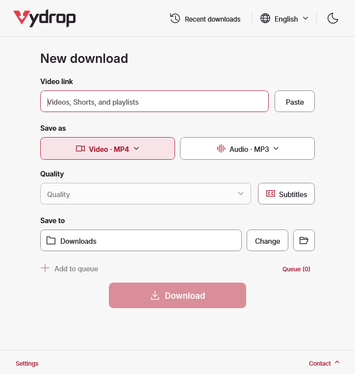

# Vydrop: free video and audio downloader for Windows

Download from YouTube, TikTok, Facebook, Vimeo and 1,000+ sites, powered by yt-dlp. Free, open source, with English and Arabic interfaces.

<a class="download" href="https://github.com/ZiadHassanein/ViFree/releases/latest">Download Vydrop for Windows</a>

## At a glance



<figure><picture><source media="(prefers-color-scheme: dark)" srcset="images/screenshots/vydrop-dark-en-download.png"></picture><figcaption>Native 100% scale client render of the 4.2.0 source interface. No mouse pointer.</figcaption></figure>

## Start with a public video link

1. Download the Windows ZIP, extract it to a writable folder, and open **Vydrop.exe**. The .NET runtime is bundled.
2. Paste a video's own link or a public playlist link. Review the detected title and available quality.
3. Choose **Video** or **Audio**, the output format, and your save folder. Select **Subtitles** if captions are available.
4. Choose **Download**. Use **Queue** for multiple links and **Recent downloads** to open completed files.

The first use may download missing media tools. No account, API key or subscription is needed. Save only media you have permission to download.

## Supported sites and formats

See [supported sites and limitations](supported-sites.md). Public pages are routed to yt-dlp; direct media files are probed for real stream information. Site access, formats and source quality determine the result. Higher output bitrates do not restore lost audio detail.

## Choose the right guide

- [Download public video from supported websites](download-video-from-any-website-windows.md)
- [Send a TikTok or Facebook video](tiktok-facebook-video-downloader-windows.md)
- [Save YouTube audio as MP3](youtube-to-mp3-windows.md)
- [Download selected playlist entries](download-youtube-playlist-windows.md)
- [Save available subtitles as SRT](youtube-subtitles-srt.md)
- [Set up Chrome, Edge or Firefox with pictures](browser-extension-setup.md)

## Why use the desktop app?

| Task | Vydrop | yt-dlp command line | Web converters |
| --- | --- | --- | --- |
| Multiple public sites | yt-dlp support in one window | yt-dlp support | Depends on the service |
| Controls | English/Arabic desktop UI | Command arguments | Browser form; varies |
| Media tools | Missing tools prepared automatically | User manages tools | Service manages tools |
| Playlists, captions, queue | App controls | Command options and scripts | Depends on the service |
| Cost and advertising | Free, no ads | Free, no ads | Pricing and ads vary |
| Browser handoff | Optional companion | Requires another integration | Varies |

Vydrop makes formats, detected quality, progress and completed files available in one local interface. The table describes workflows, not a safety ranking of other products.

## Frequently asked questions

### Can Vydrop download videos from sites other than YouTube?

Yes. Vydrop uses yt-dlp for public pages from 1,000+ supported sites, including TikTok, Facebook, Vimeo, X/Twitter, Reddit, Dailymotion and Twitch clips. Direct MP4/MP3 links also work. Site changes and access restrictions can prevent a particular download.

### Is there a free open-source Windows downloader with Arabic?

Yes. Vydrop is free under the MIT license, runs on Windows 10/11 x64, and includes English and Arabic interfaces with light and dark themes. The .NET runtime is bundled; missing media tools are prepared automatically.

### Does Vydrop download TikTok, Facebook, Vimeo or X videos?

Yes, when the public video is supported by yt-dlp and available without signing in. Paste the video’s own link, not the homepage. The extension can resolve a playing video, but custom players and site restrictions can limit detection.

### Can I download a video playing in my browser?

Use the optional Chrome, Edge or Firefox companion. Enable Browser integration in Vydrop, then click Download by Vydrop beside a playing video. It copies the resolved link and opens the app for review. You choose Download in the app; detection is not guaranteed on every website.

### How do I save a YouTube playlist as MP3 on Windows?

Paste a public playlist link, choose Whole playlist, select the entries, choose Audio → MP3 and an available audio quality, then choose Download. The app processes the selected entries in order. Available quality depends on the original audio.

### Does Vydrop need an account, API key or subscription?

No. Vydrop needs no account, API key or paid subscription. It contacts media sites and official update servers when needed. It does not import browser cookies, bypass sign-in or decrypt DRM. Only download media you have permission to save.

### What happens when a website changes?

Vydrop checks for verified yt-dlp and Deno updates once daily when you use a link and can try one compatible update-and-retry. A site may still require an upstream fix. Use Settings → Update downloader for a manual check; application updates are separate.
